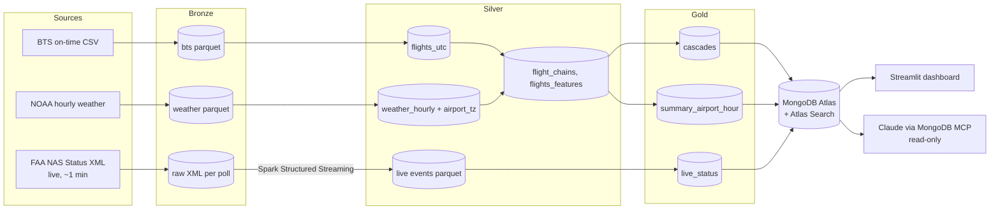

# Flight Delay Intelligence

ADSP 32030 Scalable Data Systems, final project by Olivia Yang.

## Problem

A US airline flight is often late **because the same aircraft arrived late on its previous flight**, not because of weather at the origin. This project measures how often that happens, finds the airports and hours that start **delay cascades**, separates inherited delay from weather delay, and connects the history to **live FAA airport status** so a planner can see which airports with a live problem are the ones that tend to start cascades.

Business questions
1. Which airports and which hours start the most delay cascades?
2. How much of a departure delay is inherited from the previous flight of the same aircraft vs. caused by weather at the origin?
3. Which airports with a live FAA delay or ground stop right now are cascade-prone?

**Definitions.** *Chain:* flights of one `Tail_Number` ordered by UTC departure; a flight is linked to the previous one if the previous destination equals this origin and the ground time is 0-720 min. *Inherited delay* = max(0, previous arrival delay - max(0, scheduled turnaround - 30 min)). *Cascade:* a chain of 2+ flights whose first flight departs 15+ min late. *Bad weather* = severe weather code, or visibility < 5 km, or precipitation >= 2.5 mm/h at the origin in the scheduled departure hour.

## Data

| Source | Size | Type |
|---|---|---|
| BTS On-Time Performance, 2010-01 to 2026-08 | 105,631,230 flights (22 columns), 103.4M usable for chains | batch, monthly files |
| NOAA Local Climatological Data (hourly weather), 50 airports | 10,660,339 observations | batch |
| FAA NAS Status (airport delays, ground stops, closures) | XML, updates about every minute | **live stream** |
| OurAirports (names, coordinates) | ~80k rows | reference |

Raw data is **not** in this repository (`data/` is git-ignored). Notebooks `00_*` download it.

## Architecture



| Class tool | Where it is used |
|---|---|
| **Apache Spark** | local mode (02, 03, 04, 07) and **Google Cloud Dataproc** cluster run of 03 and 04 on all years, data in Cloud Storage |
| **Spark Structured Streaming** | 07: FAA feed folder as a stream, `foreachBatch` parse + join |
| **MongoDB Atlas** (+ Atlas Search) | 05: gold tables, text search over airports and cascades |
| **Claude via MCP** | 06 + `skills.md` + `claude_mcp_log.md`: read-only questions answered by Claude over the MongoDB MCP server, checked against SQL |
| **Streamlit** | `dashboard/app.py` |
| **DuckDB** | independent SQL checks of the Spark results (02, 06) |

Medallion layers: **bronze** = raw files converted to Parquet (or raw XML); **silver** = cleaned and joined (`flights_utc`, `weather_hourly`, `airport_tz`, `flight_chains`, `flights_features`, live events); **gold** = small analysis tables served to Atlas and the dashboard (`cascades`, `summary_airport_hour`, `live_status`).

## Key findings (all years, 2010 - Aug 2026)

- A flight departing after a late inbound aircraft is delayed **35.1 min on average vs. 1.4 min** when the inbound was on time. 91.4% of flights link to a previous flight.
- **33.6%** of delayed departures (15+ min) inherit 15+ min from the previous flight.
- **3,849,908 cascades**, average 2.7 flights, longest 20 flights.
- Top cascade starters: **DFW 272,540**, ATL 262,857, ORD 260,877, DEN 193,265, CLT 129,650. By rate DFW is 62.3 per 1,000 departures.
- Weather: cascade roots start in bad weather **11.4% vs 6.3%** for all flights (1.8x), but about **89% start in good weather**.
- Delay classes (top-50 airports, delayed flights): other causes 63.3%, **inherited 30.1%**, weather 6.6%.
- Cascades per 1,000 departures dip in 2020 (17.8) and reach a high in 2025 (42.4); 2026 (Jan-Aug) is 46.8.
- Cascades peak at 08:00 and 15:00 local time.

Charts are in `figures/`; the numbers behind them in `data/propagation/tables/` (not committed; regenerated by 04).

## Repository layout

| Path | What |
|---|---|
| `00_download_bts.ipynb`, `00_download_weather.ipynb` | download BTS and NOAA, convert to Parquet (bronze) |
| `01_bts_profile.ipynb` | EDA: null rates, tail-number coverage, delay distribution, first propagation number |
| `02_spark_flights_utc.ipynb` | Spark: airport time zones, local to UTC (silver `flights_utc`) |
| `03_spark_delay_propagation.ipynb` | Spark: chains, inherited delay, weather join, cascades (silver + gold). `RUN_ON="local"` or `"gcp"` |
| `04_visuals.ipynb` | Spark SQL charts and tables (local or GCP) |
| `05_load_atlas.ipynb` | load gold tables into Atlas, create Atlas Search indexes |
| `06_ask_it_twice.ipynb` | the same five questions in SQL (DuckDB) and MQL (Atlas) |
| `07_faa_live_stream.ipynb` | live FAA feed with Spark Structured Streaming |
| `queries/` | five SQL + MQL query pairs (`q1`-`q5`) |
| `dashboard/` | Streamlit app |
| `skills.md`, `claude_mcp_log.md` | agent instructions for Claude over MCP and the full log of questions and checks |
| `samples/` | one saved FAA XML response (for replay mode) |
| `figures/` | charts used in the slides |

## How to run

Requirements: Python 3.10+, Java (for Spark), enough free disk for the Parquet data. `pip install -r requirements.txt`.

1. **Secrets (never committed).** Create `.env` in this folder:
   ```
   ATLAS_URI=<Atlas connection string of a user that can write>
   ATLAS_URI_RO=<Atlas connection string of a read-only user>
   ATLAS_DB=flightdelay
   ```
2. Run the notebooks in order: `00_download_bts`, `00_download_weather`, `01`, `02`, `03`, `04`, `05`, `06`, `07`.
   Steps 02-04 also run locally (set `RUN_ON="local"`; the setup cell uses `local[4]`, 8 GB driver memory and 400 shuffle partitions).
3. **Cluster run (all years).** Upload `data/flights_utc`, `data/weather/parquet` and `data/weather/meta/airport_tz.csv` to a Cloud Storage bucket, create a Dataproc cluster (Spark 3.5.3, image 2.3-debian12, internal IP only), upload `03` and `04`, set `BUCKET` and `RUN_ON="gcp"` in the setup cell and run all cells. Results go to `gs://<bucket>/gold`. The cluster has no internet access, so `05` and `07` run locally.
4. **Live feed:** `07` with `MODE="live"` polls `https://nasstatus.faa.gov/api/airport-status-information` once a minute for `N_POLLS` polls; `MODE="replay"` uses the saved sample.
5. **Dashboard:** `streamlit run dashboard/app.py` (reads `ATLAS_URI_RO` from `.env`, an environment variable or Streamlit secrets).
6. **Claude over MCP:** see `skills.md` for the server configuration and the instruction block.

Executed copies of the notebooks (with outputs from the cluster run) are included as `.ipynb` and `.html`.

## Notes and limitations

- Chains rely on tail numbers; the 0.42% of flights without one are all cancelled flights.
- Weather covers the top-50 airports only; cascade counts cover all airports.
- The Spark and DuckDB results for 2024 differ by 0.044% (ordering ties between flights with identical timestamps).
- FAA closures to non-scheduled transient GA are ignored for the watchlist.
- The 2026 figures cover January to August only.
